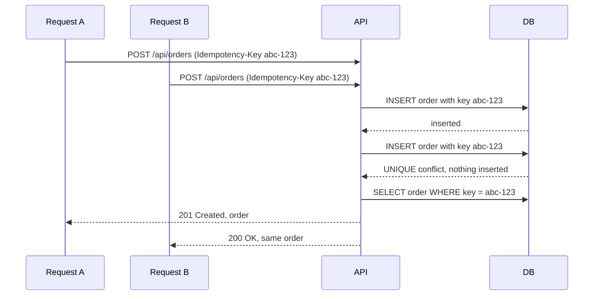
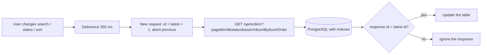

# DECISIONS

Three decisions I made in this project. Each one has the decision, one alternative I considered, and why I rejected it.

## Decision 1: Duplicate-order protection (R2)

**Decision:** The client sends an `Idempotency-Key` header with every create request. The database enforces it with `UNIQUE (idempotency_key)`. The server inserts with `onConflictDoNothing`, and if the insert did nothing, it reads and returns the existing order (`200` instead of `201`).
**Alternative:** Check first (`SELECT` by key, then `INSERT` if not found), and disable the submit button in the UI.
**Why I rejected it:** Check-then-insert has a race: two parallel requests both see "not found" and both insert. The disabled button only helps with double-clicks, not with network retries or a browser resending after a timeout. Only the database can give a real guarantee.
**Limits:**
- The key is generated per form submit. If the user reloads the page and submits again, it is a new key, so a new order.
- The server identifies a request only by its key.
- Proven with `scripts/idempotency-race-test.mjs` (5 parallel identical requests, exactly 1 row).

## Decision 2: Frontend list stays correct under fast filter changes (R1)

**Decision:** The frontend is React. On every search / status / sort change I (1) debounce search by 350 ms, (2) abort the previous request with `AbortController`, and (3) give each request an id and only apply the response if its id equals the latest request id.
**Alternative:** Debounce only (or a data-fetching library with default settings).
**Why I rejected it:** Debounce reduces the number of requests, but it does not control the order of responses. An older, slower response can still arrive last and overwrite the newest result. Abort cancels the old request, and the id check is a second safety net in case a response still gets through.
**Limits:** Abort only cancels the browser side. The server may still run the old query to the end.

## Decision 3: Authentication and token storage

**Decision:** Login sets the JWT in an **HttpOnly cookie**. The server checks every request with `jwt.verify()` (not `jwt.decode()`), using a strong secret from `.env` (at least 32 characters, never in the code). The token has an expiry (1 hour). Passwords are hashed. Role checks (for example, delete = ADMIN only) are done on the server.
**Alternative:** Return the token in the response body and keep it in `localStorage`, sent as a `Bearer` header.
**Why I rejected it:** Any XSS script can read `localStorage` and steal the token. With an HttpOnly cookie, JavaScript cannot read it.
**Limits:** The cookie does not stop an XSS script from sending requests as the user while the page is open. It also needs CSRF care (`SameSite` and a fixed allowed origin).

---

## Backend notes (from my design diagram)

- **List endpoint:** `GET /api/orders?page=1&limit=20&status=...&search=...&sortBy=createdAt&sortOrder=desc`. Server-side pagination, 20 rows per page, max 100. The full table is never sent to the browser.
- **Indexes:** I did not add any database indexes yet. This is a known gap (see "What I skipped" in the README). With 50,000 rows the list still works, but the status filter, the search and the sort do a scan. Next step would be an index on `status`, one on `created_at` / `amount` for sorting, and a trigram index for the name/email search.
- **Validation:** The same rules are checked in the frontend and again in the backend before creating the order (for example with `zod`). The server also recalculates `amount` from the line items.
- **Create order:** `POST /api/orders` + `Idempotency-Key`. The database constraint and the transaction make sure request B cannot create a second order.

### Create order, two requests with the same key

### Orders list, fast filter changes

---

## Use of AI tools

- I used an AI assistant (Claude) to help with the implementation, and to help write the README and this file.
- The decisions are mine: the idempotency approach, the request-cancel and latest-request logic, the token in an HttpOnly cookie, and the security fixes. I planned them first (see the diagram) and used AI to help build them, then reviewed and tested the result myself.
